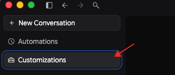
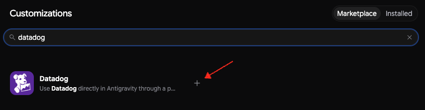
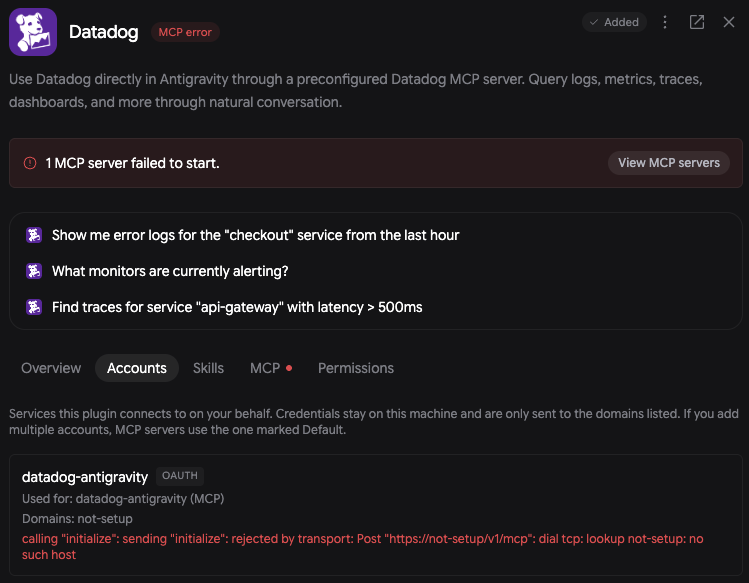
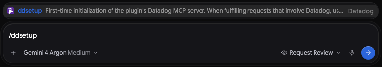
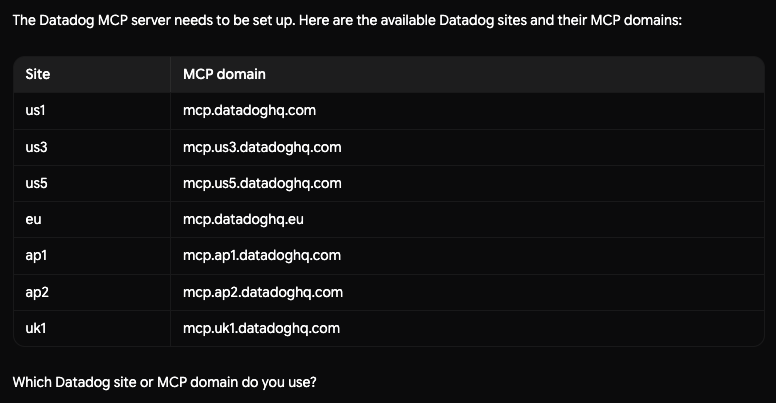
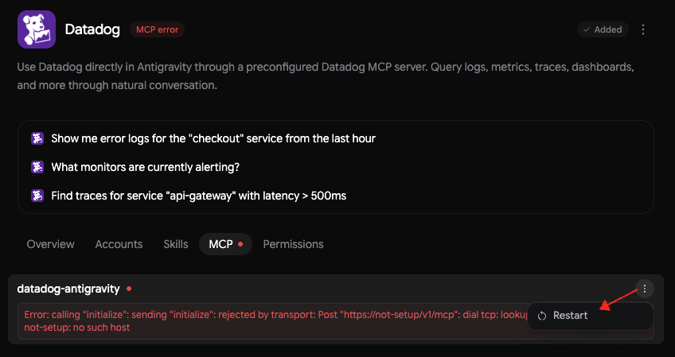
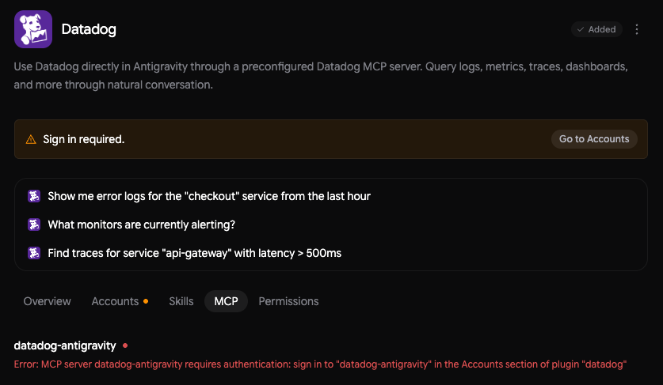
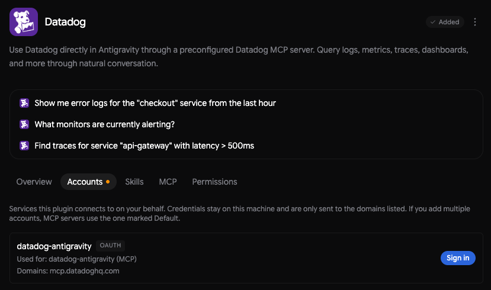
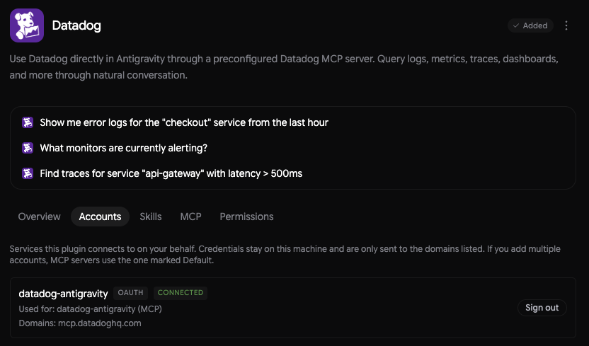

# Datadog plugin installation

## Overview

The Datadog plugin for Antigravity connects the Antigravity agent to your Datadog organization through a preconfigured Datadog MCP server. Once it's installed, you can query logs, metrics, traces, dashboards, and more in the Antigravity chat.

This guide explains how to install and configure the plugin, check that it works, and fix common problems. Installation takes four steps:

1. Install the plugin
2. Run `/ddsetup`
3. Restart the Datadog MCP server
4. Sign in to Datadog

## Prerequisites

- A Datadog account
- Antigravity installed

## Installation

### Step 1 - Install the plugin

In the Antigravity sidebar, click **Customizations**.

On the **Marketplace** tab, search for `Datadog`, then click **+** to add it.

At first, the plugin shows an MCP error on the **Accounts** tab. This is expected: the Datadog MCP server cannot start because the site is not yet configured. Proceed to [Step 2](#step-2---run-ddsetup).

### Step 2 - Run `/ddsetup`

Switch to the Antigravity chat, type `/ddsetup`, and press Enter.

The agent asks you to select a Datadog site.

If you're not sure which site you use, check the URL in your browser when you're logged in to Datadog:

| If your Datadog URL starts with | Enter | MCP domain              |
| ------------------------------- | ----- | ----------------------- |
| `https://app.datadoghq.com`     | `us1` | `mcp.datadoghq.com`     |
| `https://us3.datadoghq.com`     | `us3` | `mcp.us3.datadoghq.com` |
| `https://us5.datadoghq.com`     | `us5` | `mcp.us5.datadoghq.com` |
| `https://app.datadoghq.eu`      | `eu`  | `mcp.datadoghq.eu`      |
| `https://ap1.datadoghq.com`     | `ap1` | `mcp.ap1.datadoghq.com` |
| `https://ap2.datadoghq.com`     | `ap2` | `mcp.ap2.datadoghq.com` |
| `https://uk1.datadoghq.com`     | `uk1` | `mcp.uk1.datadoghq.com` |

For more information, see [Getting Started with Datadog Sites](https://docs.datadoghq.com/getting_started/site/).

Enter your Datadog site (for example, `us1`) and wait for the agent to update your Datadog MCP connection URL.

### Step 3 - Restart the Datadog MCP server

Restart the MCP server so it uses the new site:

1. Open **Customizations** and select the Datadog plugin from the **Installed** tab.
2. Open the plugin's **MCP** tab.
3. Click the ⋮ menu next to `datadog-antigravity`, then select **Restart**.

A **Sign in required** banner appears. Click **Go to Accounts**.

### Step 4 - Sign in to Datadog

On the **Accounts** tab, click **Sign in**.

A browser window opens. Log in to Datadog if you aren't already logged in, then approve the request to give Antigravity access to your Datadog account. Return to Antigravity when you're done.

When sign-in succeeds, the account shows a **CONNECTED** badge.

## Verify the installation

To confirm the plugin is working, open a new conversation in the Antigravity chat and ask a question about your Datadog data, for example:

- `What monitors are currently alerting?`
- `Show me error logs from the last hour`

The agent should call the Datadog MCP server and return results from your Datadog organization. If it reports an authentication or connection error instead, go back to the plugin's **Accounts** tab and check that it shows **CONNECTED**.

## Troubleshooting

### The MCP server still shows an error after restarting

If the **MCP** tab still shows an error containing `not-setup`, the site wasn't saved. Run `/ddsetup` again, enter your site, then restart the MCP server as described in [Step 3](#step-3---restart-the-datadog-mcp-server).

### Sign-in fails, or you see no data after signing in

You may have selected the wrong Datadog site. Check which site you use with the table in [Step 2](#step-2---run-ddsetup). On the **Accounts** tab, check that **Domains** shows the MCP domain for that site (for example, `mcp.datadoghq.com` for `us1`).

To change the site, see [Changing your site or organization later](#changing-your-site-or-organization-later).

### The plugin stopped working after an update

Updating the plugin resets its configuration, including your Datadog site. Run `/ddsetup` again, then [restart the MCP server](#step-3---restart-the-datadog-mcp-server) and [sign in again](#step-4---sign-in-to-datadog).

### Conflicts with another Datadog MCP server

If you already registered a Datadog MCP server yourself, for example a `datadog` entry in your own `mcp_config.json`, the agent may call that server instead of the plugin's `datadog-antigravity` server. Disable or remove your own entry to avoid conflicts.

### Changing your site or organization later

Run `/ddconfig` in the chat. It can change the Datadog site, switch to a different organization, or troubleshoot a server that was previously working but has stopped responding.

- **After changing the site**, [restart the MCP server](#step-3---restart-the-datadog-mcp-server) and [sign in again](#step-4---sign-in-to-datadog).
- **To switch to another organization on the same site**, open the plugin's **Accounts** tab, click **Sign out**, then click **Sign in** and choose the target organization in the browser. Restarting the MCP server isn't enough, because the server keeps your current sign-in.
